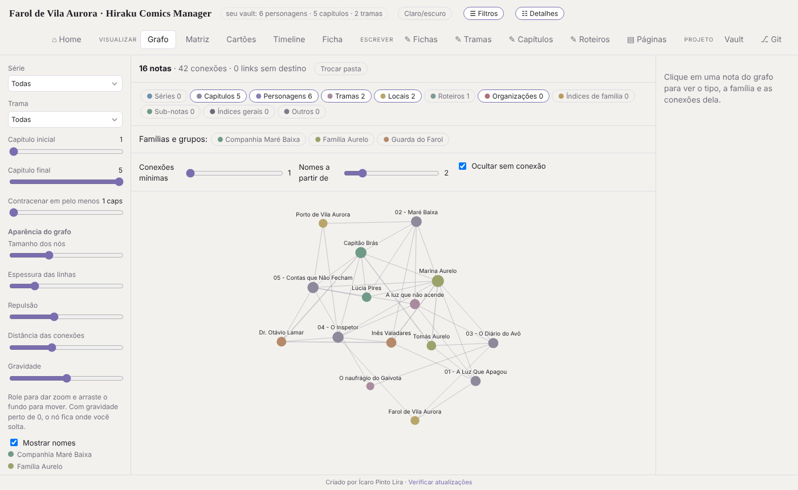
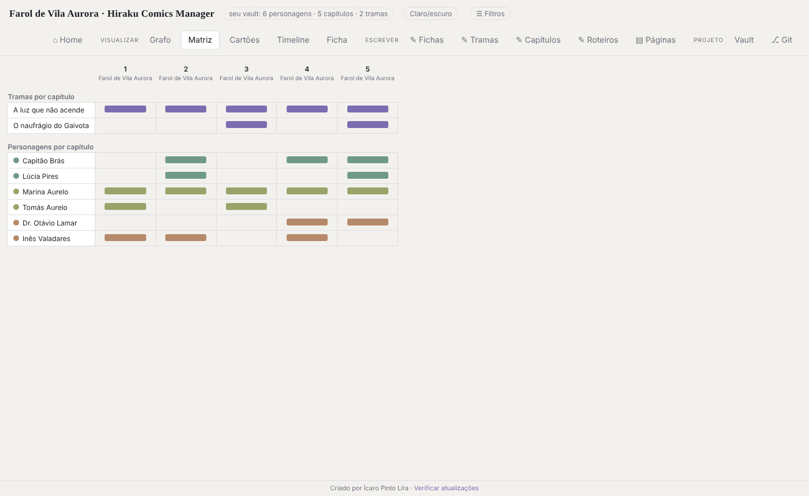
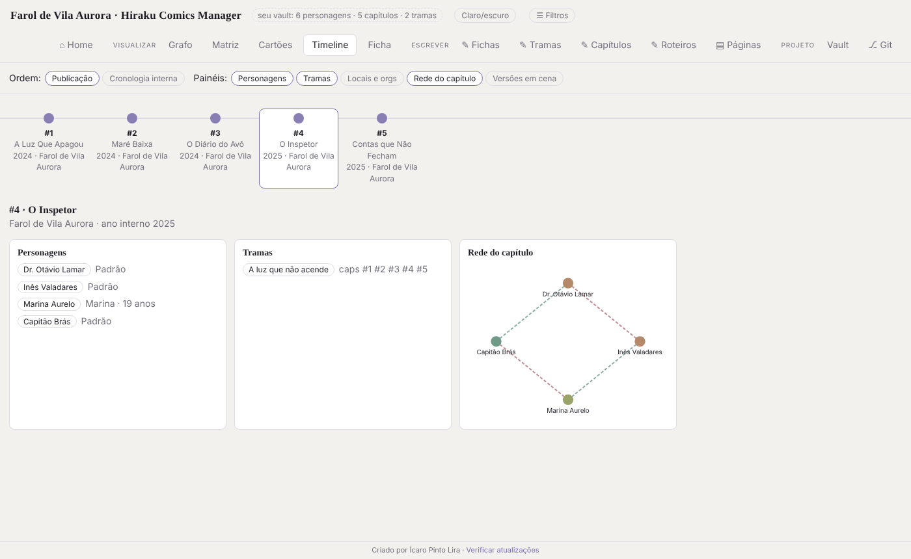
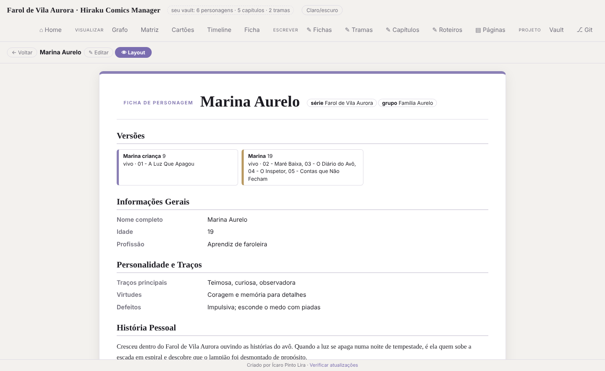
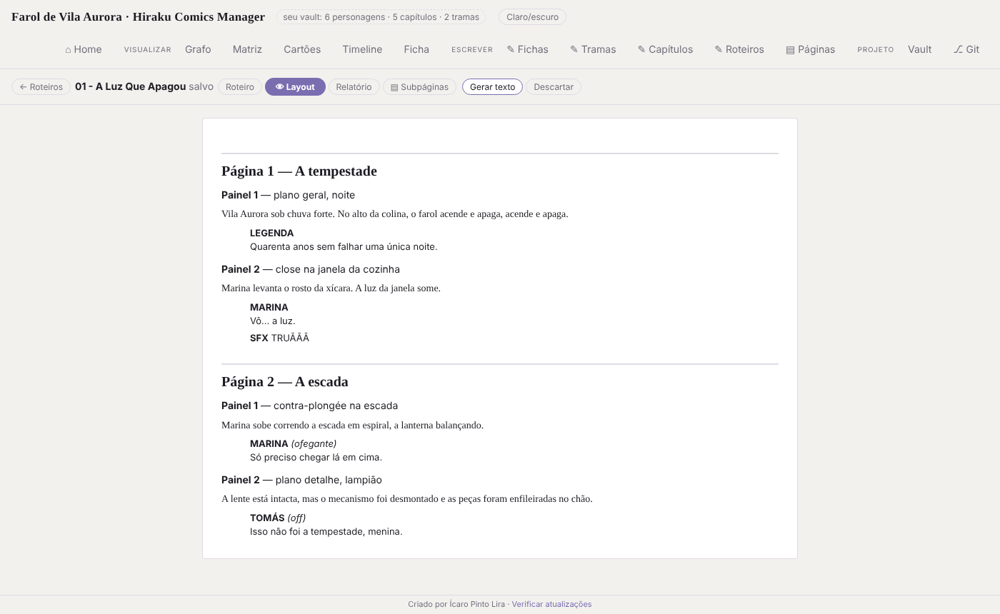

<div align="center">


# Hiraku Comics Manager

**Organize personagens, tramas, capítulos e roteiros da sua história num só lugar.**
Seus arquivos continuam sendo Markdown comum, e a colaboração por GitHub acontece sozinha.

[](https://github.com/IcaropLira/HirakuComicManager/releases/latest)
[](https://github.com/IcaropLira/HirakuComicManager/releases)

[](https://v2.tauri.app/)

[**Baixar**](#-baixar) · [**Primeiros passos**](#-primeiros-passos) · [**Trabalhando em dupla**](#-trabalhando-em-dupla-com-o-github) · [**Dúvidas**](#-dúvidas-frequentes)

<br>



<sub>Vault de exemplo incluído no repositório (pasta <code>exemplo/</code>): <i>O Farol de Vila Aurora</i>, uma história fictícia criada só para demonstração.</sub>

</div>

<br>

## Para que serve

Quem escreve uma história longa acaba com dezenas de fichas, capítulos e anotações espalhados. O Hiraku lê uma pasta de notas em Markdown (o **Vault**) e transforma os links `[[entre notas]]` em mapas, tabelas e linhas do tempo. Tudo o que você edita volta para o arquivo `.md`, sem formato proprietário, e continua abrindo no Obsidian ou em qualquer editor de texto.

- **Veja a história inteira:** quem aparece em cada capítulo, quais tramas se cruzam, como os personagens se relacionam.
- **Escreva em blocos:** fichas, tramas, capítulos e roteiros de quadrinhos, cada um com um modo **Layout** de leitura.
- **Trabalhe em dupla ou em equipe:** commit, push, pull e merge automáticos pelo GitHub, sem abrir o terminal.
- **Fique sempre atualizado:** o app avisa quando existe versão nova e se atualiza sozinho.

## Recursos

### Visualizar a história

<table>
<tr>
<td width="50%"><br><b>Matriz</b><br>Quem aparece em cada capítulo e quais tramas correm em paralelo.</td>
<td width="50%"><br><b>Timeline</b><br>Capítulos por ordem de publicação ou cronologia interna, com elenco, tramas e a rede de cada capítulo.</td>
</tr>
</table>

O **Grafo** (imagem do topo) mostra notas, personagens e conexões, com filtros por série, trama e capítulo. Há também **Cartões** de capítulos e a **Ficha** rápida de cada personagem, com rede de relações e versões.

### Escrever

<table>
<tr>
<td width="50%"><br><b>Fichas, tramas e capítulos</b><br>Editor em blocos e um modo <b>👁 Layout</b> com a leitura limpa da ficha, incluindo versões do personagem por capítulo.</td>
<td width="50%"><br><b>Roteiros</b> (Hiraku Comics Editor)<br>Páginas, painéis, falas, legendas e SFX, com Layout para leitura e Relatório (palavras por painel, quem mais fala).</td>
</tr>
</table>

**Subpáginas:** qualquer nota pode ter páginas dentro dela (fichas, tramas, capítulos e roteiros). No disco, a nota `X.md` é a página-pai das notas que estão na pasta `X/`.

**Páginas:** um bloco de notas livre, com páginas dentro de páginas, para rascunhos. Elas ficam guardadas só dentro do app, neste computador; **não** vão para o Vault nem para o Git. Para algo que precisa ser compartilhado, use as subpáginas de uma nota.

### Projeto

- **Vault:** escolha da pasta, classificação das notas por tipo e revisão, incluindo links `[[...]]` quebrados.
- **Git:** login no GitHub, histórico, commits e sincronização. Veja [Trabalhando em dupla](#-trabalhando-em-dupla-com-o-github).

## 📥 Baixar

Baixe o instalador na página de [**Releases**](https://github.com/IcaropLira/HirakuComicManager/releases/latest):

| Sistema | Arquivo |
| --- | --- |
| Windows | `*-setup.exe` (instalador, cria atalhos) ou `.msi` |
| macOS | `.dmg` |
| Debian / Ubuntu | `.deb` |
| Fedora e derivados | `.rpm` |
| Qualquer Linux | `.AppImage` (portátil: dê permissão de execução e abra) |

Depois da primeira instalação o app se atualiza sozinho. Veja [Atualização automática](#-atualização-automática).

## 🚀 Primeiros passos

1. Abra o app e, na **Home**, clique em **Escolher pasta…** e aponte para o seu Vault. O app lembra da última pasta.
2. Quer só conhecer? Escolha a pasta [`exemplo/`](exemplo) deste repositório: ela traz 6 personagens, 5 capítulos, 2 tramas, 2 locais e um roteiro.
3. Já tem a história num repositório do GitHub? Use **Clonar projeto** na Home, informe o URL e escolha onde criar a pasta.
4. Edite à vontade. **Salvar no arquivo** grava o `.md` e deixa uma cópia `arquivo.md.bak` ao lado (os `.bak` entram no `.gitignore` sozinhos).

### Como o Vault é organizado

O app reconhece as notas pela pasta e pelo campo `tipo` no começo do arquivo:

```text
Meu Vault/
└── Nome da Série/
    ├── Fichas de Personagem/
    │   └── Família Aurelo/        ← a pasta de dentro vira o "grupo" do personagem
    │       └── Marina Aurelo.md
    ├── Capítulos/                 01 - A Luz Que Apagou.md
    ├── Tramas/                    A luz que não acende.md
    ├── Locais/                    Farol de Vila Aurora.md
    └── Roteiros/                  Roteiro — 01 - A Luz Que Apagou.md
```

Uma ficha de personagem, com duas versões ao longo da história:

```markdown
---
tipo: personagem
versoes:
  - nome: Marina criança
    idade: 9
    status: vivo
    caps: ["01 - A Luz Que Apagou"]
  - nome: Marina
    idade: 19
    status: vivo
    caps: ["02 - Maré Baixa", "03 - O Diário do Avô"]
---

### Informações Gerais
- **Nome completo:** Marina Aurelo
- **Idade:** 19

---
### Relações e Conflitos
- [[Tomás Aurelo]] #rel/família
    O avô, guardião do farol há quarenta anos.
- [[Capitão Brás]] #rel/rival
```

Para ligar notas, escreva `[[Nome da nota]]`. É isso que forma o grafo, a matriz e o "Aparece em". Um capítulo lista o **Elenco**, as **Tramas** e os **Locais** do mesmo jeito. Tipos aceitos: `personagem`, `trama`, `capitulo`, `roteiro`, `local`, `org` e `sub`. Tipos de relação (`#rel/...`): aliado, rival, família, mentor, antagonista, amor.

## 🤝 Trabalhando em dupla com o GitHub

Na aba **⎇ Git**:

1. Clique em **Entrar com GitHub**. O app mostra um código e abre o navegador; você digita o código no GitHub e autoriza. Sem senha e sem terminal. O login fica guardado no Git do sistema (o mesmo que o `git push` usa) e **não** dentro do Vault.
2. Cole o URL do repositório em **Conectar repositório**, ou use o Vault que você clonou.
3. Cada pessoa que for sincronizar precisa ser colaboradora do repositório.

Com **Automático** ligado (já vem ligado), o app faz sozinho o que você faria no GitHub Desktop:

| Quando | O que acontece |
| --- | --- |
| Você salva uma nota | Puxa o remoto, faz o commit e envia (push). |
| O app abre, a cada minuto ou quando a janela volta ao foco | Consulta o remoto. Se alguém enviou alterações, avisa e faz o pull e o merge, e o Vault recarrega. |
| Você está com um editor aberto | O aviso espera. O app só puxa depois que você salvar e sair, para nunca sobrescrever o que está escrevendo. |
| Automático desligado | O aviso traz o botão **Puxar e mesclar**, e a aba Git tem commit, pull e sync manuais. |

O pull usa `pull --rebase --autostash`, então o que você ainda não commitou é preservado. Se duas pessoas editarem o mesmo trecho, o app **desfaz o rebase** (o Vault não fica com marcadores `<<<<<<<`), avisa quais arquivos conflitaram e deixa a resolução para vocês, combinando entre si ou usando `git pull --rebase` num terminal.

> **Dica:** evitem editar a mesma nota ao mesmo tempo e deixem o Automático ligado nos dois computadores.

## 🔄 Atualização automática

O app procura versões novas ao abrir (e a cada 6 horas) e mostra um aviso com **Atualizar agora**. Também dá para conferir em **Verificar atualizações**, no rodapé. A atualização silenciosa vale para Windows, macOS e AppImage; instalações `.deb` e `.rpm` são atualizadas pelo gerenciador de pacotes do sistema.

## ❓ Dúvidas frequentes

**Funciona com o Obsidian?** Sim. O Vault é uma pasta de arquivos Markdown com links `[[...]]`, e você pode abrir a mesma pasta nos dois.

**Meus arquivos vão para a nuvem?** Não, a menos que você conecte um repositório do GitHub. As notas ficam na sua pasta. O app só se conecta à internet para entrar e sincronizar com o GitHub (se você usar esse recurso) e para procurar atualizações.

**E se eu e meu amigo editarmos o mesmo arquivo?** Se as alterações forem em trechos diferentes, o merge é automático. Se forem no mesmo trecho, o app avisa o conflito sem mexer no seu Vault.

**O login do GitHub guarda minha senha?** Não. O GitHub devolve um token de acesso, que fica no gerenciador de credenciais do Git do seu sistema. Para sair, use **Sair** na aba Git.

**Por que as "Páginas" não aparecem no meu amigo?** Elas ficam só dentro do app, no seu computador. Use subpáginas de uma nota (arquivos `.md` no Vault) para compartilhar.

## 🛠️ Desenvolvimento

Requisitos: [Node 22+](https://nodejs.org/) e os [pré-requisitos do Tauri](https://v2.tauri.app/start/prerequisites/) (Rust e as dependências do seu sistema).

```bash
npm install     # também copia o d3 para src/
npm run dev     # abre o app em modo desenvolvimento
npm run build   # gera os instaladores do seu sistema
```

- `src/index.html`: toda a interface.
- `src-tauri/src/main.rs`: comandos nativos (arquivos do Vault, Git, login do GitHub).
- `exemplo/`: Vault de exemplo, útil para testar mudanças.
- Para trocar o ícone: `npx tauri icon caminho/para/logo.png`.

<details>
<summary><b>Configurar o login do GitHub</b> (uma vez, para quem publica o app)</summary>

O login usa o *Device Flow* do GitHub. Em [github.com/settings/developers](https://github.com/settings/developers) crie um **OAuth App**, marque **Enable Device Flow** e cole o **Client ID** (é público, não é segredo) em `GITHUB_CLIENT_ID` no `src-tauri/src/main.rs`. O escopo pedido é `repo`, necessário para repositórios privados.

</details>

<details>
<summary><b>Publicar uma versão</b></summary>

Envie uma tag `v*`: o workflow compila Linux (DEB, RPM, AppImage), Windows (MSI, NSIS) e macOS (DMG), cria o GitHub Release e anexa o `latest.json` que os apps instalados consultam. A versão da tag é aplicada sozinha a `package.json`, `Cargo.toml` e `tauri.conf.json`.

```bash
git tag v0.2.0
git push origin v0.2.0
```

Configuração única da assinatura das atualizações:

1. `npx tauri signer generate -w ~/.tauri/hiraku.key` e guarde a chave privada em local seguro (se perdê-la, os apps instalados deixam de aceitar atualizações).
2. Cole a chave pública (`hiraku.key.pub`) em `src-tauri/tauri.conf.json`, no campo `plugins.updater.pubkey`.
3. No GitHub, em *Settings → Secrets and variables → Actions*, crie `TAURI_SIGNING_PRIVATE_KEY` (conteúdo da chave privada) e, se a chave tiver senha, `TAURI_SIGNING_PRIVATE_KEY_PASSWORD`.

Flatpak ainda não é gerado pelo workflow (precisa de manifesto e publicação próprios).

</details>

---

<div align="center">
<sub>Criado por <a href="https://github.com/IcaropLira">Ícaro Pinto Lira</a>. A história do <code>exemplo/</code> é fictícia e foi escrita só para demonstrar o app.</sub>
</div>
